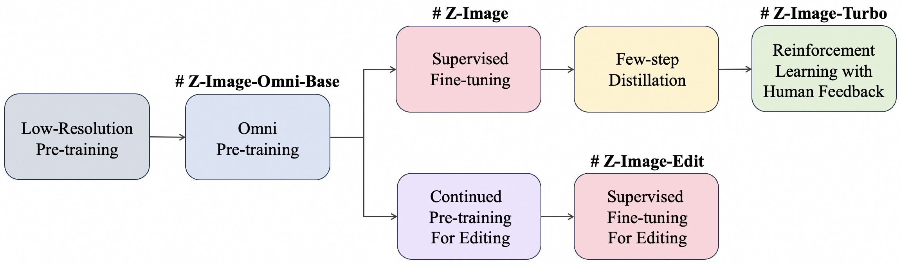
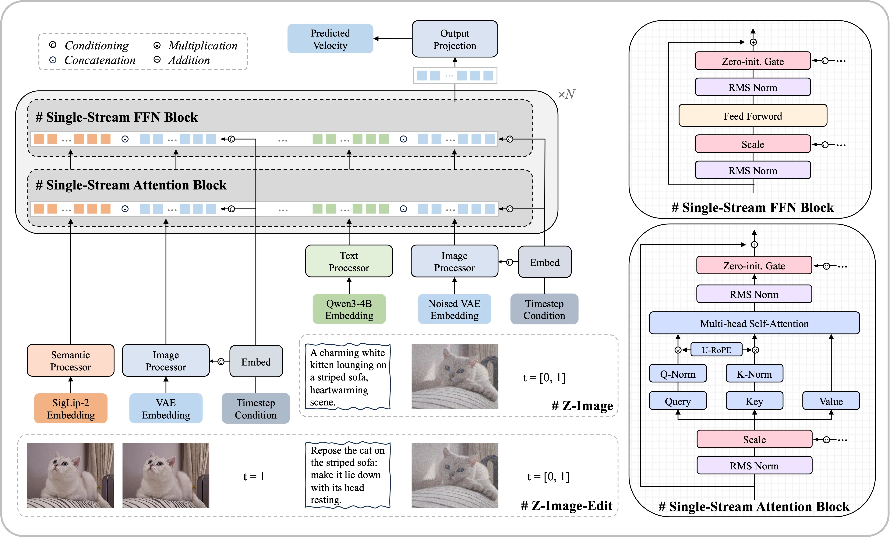
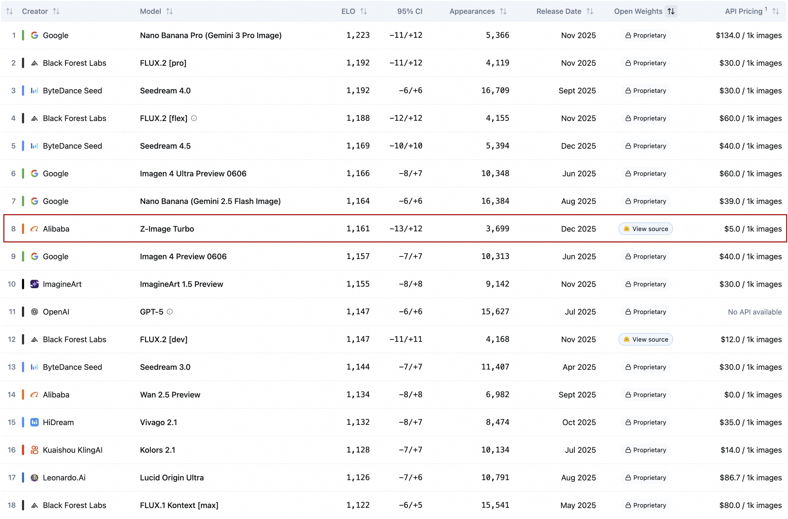
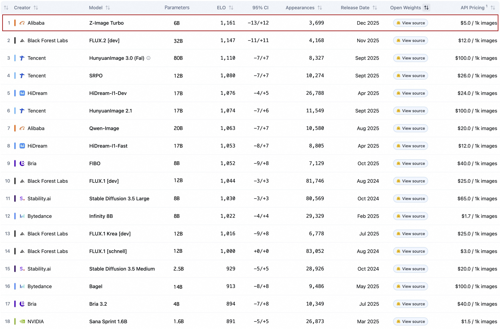
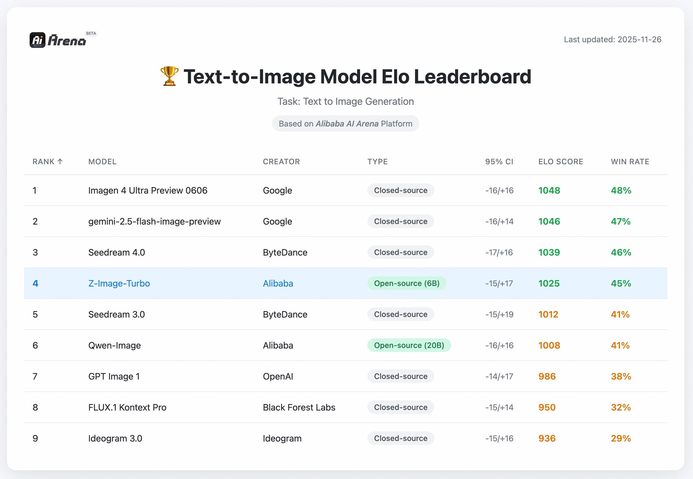
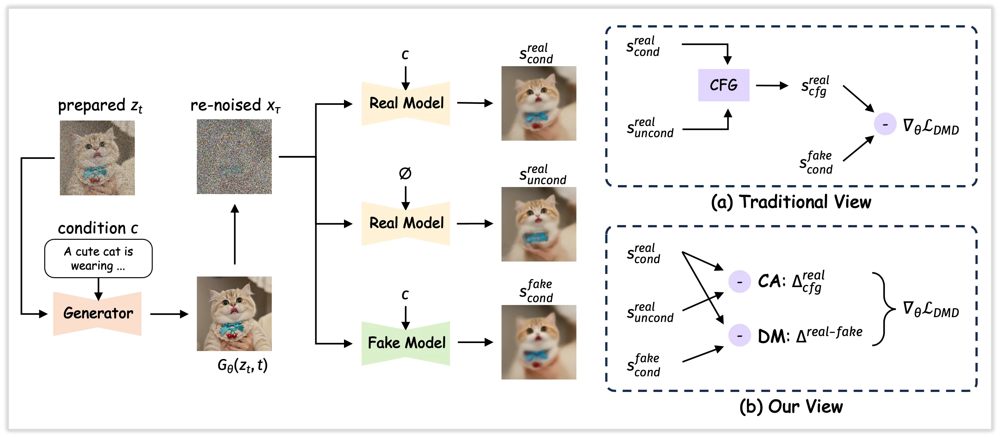
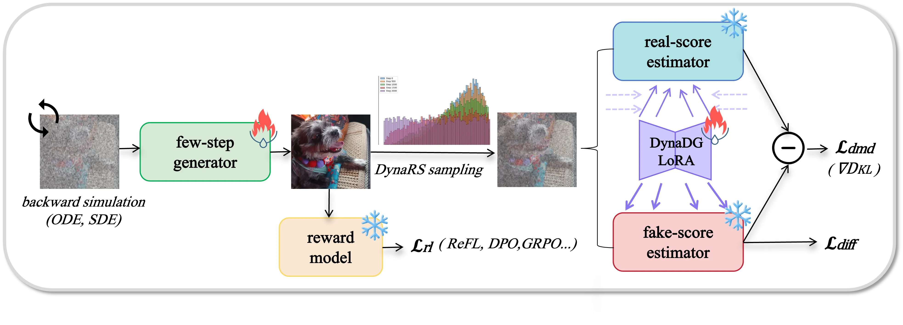

<h1 align="center">⚡️- Image<br><sub><sup>An Efficient Image Generation Foundation Model with Single-Stream Diffusion Transformer</sup></sub></h1>

<div align="center">

[](https://tongyi-mai.github.io/Z-Image-blog/)&#160;
[](https://huggingface.co/Tongyi-MAI/Z-Image)&#160;
[](https://huggingface.co/Tongyi-MAI/Z-Image-Turbo)&#160;
[](https://huggingface.co/spaces/Tongyi-MAI/Z-Image)&#160;
[](https://huggingface.co/spaces/Tongyi-MAI/Z-Image-Turbo)&#160;
[](https://www.modelscope.cn/models/Tongyi-MAI/Z-Image)&#160;
[](https://www.modelscope.cn/models/Tongyi-MAI/Z-Image-Turbo)&#160;
[](https://www.modelscope.cn/aigc/imageGeneration?tab=advanced&versionId=569345&modelType=Checkpoint&sdVersion=Z_IMAGE&modelUrl=modelscope%3A%2F%2FTongyi-MAI%2FZ-Image%3Frevision%3Dmaster)&#160;
[](https://www.modelscope.cn/aigc/imageGeneration?tab=advanced&versionId=469191&modelType=Checkpoint&sdVersion=Z_IMAGE_TURBO&modelUrl=modelscope%3A%2F%2FTongyi-MAI%2FZ-Image-Turbo%3Frevision%3Dmaster)&#160;
[](assets/Z-Image-Gallery.pdf)&#160;
[](https://modelscope.cn/studios/Tongyi-MAI/Z-Image-Gallery/summary)&#160;
<a href="https://arxiv.org/abs/2511.22699" target="_blank"></a>


Welcome to the official repository for the Z-Image（造相）project!

</div>

## ⚡ How to Run (API + Frontend)

Use the root startup launcher to create `.venv`, install dependencies, run checks/builds, and start both services.

Prerequisites:

- Python 3.10+
- Node.js 20+
- npm

From repository root:

Linux / macOS:

```bash
chmod +x run.sh
./run.sh
```

Windows (PowerShell):

```powershell
.\run.ps1
```

Windows (CMD):

```bat
run.bat
```

Default endpoints:

- Backend API: `http://localhost:9090`
- Frontend UI: `http://localhost:4040`

Useful toggles:

```bash
RUN_FRONTEND_BUILD=0 ./run.sh
RUN_FRONTEND_CHECK=0 ./run.sh
RUN_PYTHON_BOOTSTRAP=0 ./run.sh
```

These environment variables also work with `run.py`, `run.ps1`, and `run.bat`.

## 🤝 Collaboration & Ministry Vision

We are currently seeking **international Christian collaborators, ministries, and partners** for a multi-million peso proposal to build an **AI-generated illustrative online Bible software platform**.

If your ministry, church, organization, or technical team is interested in collaboration, please reach out.

Current illustration concept: **Adam and Eve depicted in the garden**.

<table>
  <tr>
    <td></td>
    <td></td>
    <td></td>
  </tr>
  <tr>
    <td></td>
    <td></td>
    <td></td>
  </tr>
</table>

### Infrastructure Vision (Self-Hosted Cloud / Home Data Center)

- Power baseline: **20KW**
- Regional scaling hardware target: **NVIDIA HGX H100**
- Cost categories:
  - Building cost
  - Regulatory compliance cost
  - Labor cost
  - Engineering cost (including senior engineers; some roles may require Master’s/PhD-level expertise)
  - Data science and software development teams

Estimated scaling budgets:

- **Regional scaling:** PHP **5M–10M**
- **National scaling:** PHP **100M–200M**, with **2MW solar + datacenter**
- **International scaling:** PHP **500M–500B**, including long-term vision for **1GW solar + cloud-scale infrastructure**, and a Christian Metro Studio Complex for large-scale community compute and employment.

### Ministry Backdrop Verse

**Ephesians 1:22-23 (AMP)**

"And He put all things [in every realm] in subjection under Christ’s feet, and appointed Him as [supreme and authoritative] head over all things in the church, which is His body, the fullness of Him who fills and completes all things in all [believers]."


## ✨ Z-Image

Z-Image is a powerful and highly efficient image generation model family with **6B** parameters. Currently there are four variants:

- 🚀 **Z-Image-Turbo** – A distilled version of Z-Image that matches or exceeds leading competitors with only **8 NFEs** (Number of Function Evaluations). It offers **⚡️sub-second inference latency⚡️** on enterprise-grade H800 GPUs and fits comfortably within **16G VRAM consumer devices**. It excels in photorealistic image generation, bilingual text rendering (English & Chinese), and robust instruction adherence.

- 🎨 **Z-Image** – The foundation model behind Z-Image-Turbo. Z-Image focuses on **high-quality generation**, **rich aesthetics**, **strong diversity**, and **controllability**, well-suited for creative generation, **fine-tuning**, and downstream development. It supports a wide range of artistic styles, effective negative prompting, and high diversity across identities, poses, compositions, and layouts.

- 🧱 **Z-Image-Omni-Base** – The versatile foundation model capable of both **generation and editing tasks**. By releasing this checkpoint, we aim to unlock the full potential for community-driven fine-tuning and custom development, providing the most "raw" and diverse starting point for the open-source community.

- ✍️ **Z-Image-Edit** – A variant fine-tuned on Z-Image specifically for image editing tasks. It supports creative image-to-image generation with impressive instruction-following capabilities, allowing for precise edits based on natural language prompts.

### 📣 News

*   **[2026-01-27]** 🔥 **Z-Image is released!** We have released the model checkpoint on [Hugging Face](https://huggingface.co/Tongyi-MAI/Z-Image) and [ModelScope](https://www.modelscope.cn/models/Tongyi-MAI/Z-Image). Try our [online demo](https://www.modelscope.cn/aigc/imageGeneration?tab=advanced&versionId=569345&modelType=Checkpoint&sdVersion=Z_IMAGE&modelUrl=modelscope%3A%2F%2FTongyi-MAI%2FZ-Image%3Frevision%3Dmaster)!
*   **[2025-12-08]** 🏆 Z-Image-Turbo ranked 8th overall on the **Artificial Analysis Text-to-Image Leaderboard**, making it the 🥇 <strong style="color: #FFC300;">#1 open-source model</strong>! [Check out the full leaderboard](https://artificialanalysis.ai/image/leaderboard/text-to-image).
*   **[2025-12-01]** 🎉 Our technical report for Z-Image is now available on [arXiv](https://arxiv.org/abs/2511.22699).
*   **[2025-11-26]** 🔥 **Z-Image-Turbo is released!** We have released the model checkpoint on [Hugging Face](https://huggingface.co/Tongyi-MAI/Z-Image-Turbo) and [ModelScope](https://www.modelscope.cn/models/Tongyi-MAI/Z-Image-Turbo). Try our [online demo](https://huggingface.co/spaces/Tongyi-MAI/Z-Image-Turbo)!

### 📥 Model Zoo

| Model | Pre-Training | SFT | RL | Step | CFG | Task | Visual Quality | Diversity | Fine-Tunability | Hugging Face | ModelScope |
| :--- | :---: | :---: | :---: | :---: | :---: | :---: | :---: | :---: | :---: | :---: | :---: |
| **Z-Image-Omni-Base** | ✅ | ❌ | ❌ | 50 | ✅ | Gen. / Editing | Medium | High | Easy | *To be released* | *To be released* |
| **Z-Image** | ✅ | ✅ | ❌ | 50 | ✅ | Gen. | High | Medium | Easy | [](https://huggingface.co/Tongyi-MAI/Z-Image) <br> [](https://huggingface.co/spaces/Tongyi-MAI/Z-Image) | [](https://www.modelscope.cn/models/Tongyi-MAI/Z-Image) <br> [](https://www.modelscope.cn/aigc/imageGeneration?tab=advanced&versionId=569345&modelType=Checkpoint&sdVersion=Z_IMAGE&modelUrl=modelscope%3A%2F%2FTongyi-MAI%2FZ-Image%3Frevision%3Dmaster) |
| **Z-Image-Turbo** | ✅ | ✅ | ✅ | 8 | ❌ | Gen. | Very High | Low | N/A | [](https://huggingface.co/Tongyi-MAI/Z-Image-Turbo) <br> [](https://huggingface.co/spaces/Tongyi-MAI/Z-Image-Turbo) | [](https://www.modelscope.cn/models/Tongyi-MAI/Z-Image-Turbo) <br> [](https://www.modelscope.cn/aigc/imageGeneration?tab=advanced&versionId=469191&modelType=Checkpoint&sdVersion=Z_IMAGE_TURBO&modelUrl=modelscope%3A%2F%2FTongyi-MAI%2FZ-Image-Turbo%3Frevision%3Dmaster) |
| **Z-Image-Edit** | ✅ | ✅ | ❌ | 50 | ✅ | Editing | High | Medium | Easy | *To be released* | *To be released* |

The figure below illustrates at which training stage each model is produced.



### 🖼️ Showcase

📸 **Photorealistic Quality**: **Z-Image-Turbo** delivers strong photorealistic image generation while maintaining excellent aesthetic quality.


📖 **Accurate Bilingual Text Rendering**: **Z-Image-Turbo** excels at accurately rendering complex Chinese and English text.


💡  **Prompt Enhancing & Reasoning**: Prompt Enhancer empowers the model with reasoning capabilities, enabling it to transcend surface-level descriptions and tap into underlying world knowledge.


🧠 **Creative Image Editing**: **Z-Image-Edit** shows a strong understanding of bilingual editing instructions, enabling imaginative and flexible image transformations.


### 🏗️ Model Architecture
We adopt a **Scalable Single-Stream DiT** (S3-DiT) architecture. In this setup, text, visual semantic tokens, and image VAE tokens are concatenated at the sequence level to serve as a unified input stream, maximizing parameter efficiency compared to dual-stream approaches.



### 📈 Performance

Z-Image-Turbo's performance has been validated on multiple independent benchmarks, where it consistently demonstrates state-of-the-art results, especially as the leading open-source model.

#### Artificial Analysis Text-to-Image Leaderboard
On the highly competitive [Artificial Analysis Leaderboard](https://artificialanalysis.ai/image/leaderboard/text-to-image), Z-Image-Turbo ranked **8th overall** and secured the top position as the 🥇 <strong style="color: gold;">#1 Open-Source Model</strong>, outperforming all other open-source alternatives.


<p align="center">
  <a href="https://artificialanalysis.ai/image/leaderboard/text-to-image">
    <br />
    <span style="font-size:1.05em; cursor:pointer; text-decoration:underline;"> Artificial Analysis Leaderboard</span>
  </a>
</p>

<p align="center">
  <a href="https://artificialanalysis.ai/image/leaderboard/text-to-image">
    <br />
    <span style="font-size:1.05em; cursor:pointer; text-decoration:underline;"> Artificial Analysis Leaderboard (Open-Source Model Only)</span>
  </a>
</p>

#### Alibaba AI Arena Text-to-Image Leaderboard
According to the Elo-based Human Preference Evaluation on [*Alibaba AI Arena*](https://aiarena.alibaba-inc.com/corpora/arena/leaderboard?arenaType=T2I), Z-Image-Turbo also achieves state-of-the-art results among open-source models and shows highly competitive performance against leading proprietary models.

<p align="center">
  <a href="https://aiarena.alibaba-inc.com/corpora/arena/leaderboard?arenaType=T2I">
    <br />
    <span style="font-size:1.05em; cursor:pointer; text-decoration:underline;"> Alibaba AI Arena Text-to-Image Leaderboard</span>
  </a>
</p>


### 🚀 Quick Start
#### (1) PyTorch Native Inference
Build a virtual environment you like and then install the dependencies:
```bash
pip install -e .
```
Then run the following code to generate an image:
```bash
python inference.py
```

#### (2) Diffusers Inference
Install the latest version of diffusers, use the following command:
<details>
  <summary>Click here for details for why you need to install diffusers from source</summary>

  We have submitted two pull requests ([#12703](https://github.com/huggingface/diffusers/pull/12703) and [#12715](https://github.com/huggingface/diffusers/pull/12715)) to the 🤗 diffusers repository to add support for Z-Image. Both PRs have been merged into the latest official diffusers release.
  Therefore, you need to install diffusers from source for the latest features and Z-Image support.

</details>

```bash
pip install git+https://github.com/huggingface/diffusers
```

<details>
<summary><b>Z-Image-Turbo</b> - Click to expand</summary>

Then, try the following code to generate an image:
```python
import torch
from diffusers import ZImagePipeline

# 1. Load the pipeline
# Use bfloat16 for optimal performance on supported GPUs
pipe = ZImagePipeline.from_pretrained(
    "Tongyi-MAI/Z-Image-Turbo",
    torch_dtype=torch.bfloat16,
    low_cpu_mem_usage=False,
)
pipe.to("cuda")

# [Optional] Attention Backend
# Diffusers uses SDPA by default. Switch to Flash Attention for better efficiency if supported:
# pipe.transformer.set_attention_backend("flash")    # Enable Flash-Attention-2
# pipe.transformer.set_attention_backend("_flash_3") # Enable Flash-Attention-3

# [Optional] Model Compilation
# Compiling the DiT model accelerates inference, but the first run will take longer to compile.
# pipe.transformer.compile()

# [Optional] CPU Offloading
# Enable CPU offloading for memory-constrained devices.
# pipe.enable_model_cpu_offload()

prompt = "Young Chinese woman in red Hanfu, intricate embroidery. Impeccable makeup, red floral forehead pattern. Elaborate high bun, golden phoenix headdress, red flowers, beads. Holds round folding fan with lady, trees, bird. Neon lightning-bolt lamp (⚡️), bright yellow glow, above extended left palm. Soft-lit outdoor night background, silhouetted tiered pagoda (西安大雁塔), blurred colorful distant lights."

# 2. Generate Image
image = pipe(
    prompt=prompt,
    height=1024,
    width=1024,
    num_inference_steps=9,  # This actually results in 8 DiT forwards
    guidance_scale=0.0,     # Guidance should be 0 for the Turbo models
    generator=torch.Generator("cuda").manual_seed(42),
).images[0]

image.save("example.png")
```

</details>

<details>
<summary><b>Z-Image</b> - Click to expand</summary>

Recommended Parameters:
- **Resolution:** 512×512 to 2048×2048 (total pixel area, any aspect ratio)
- **Guidance scale:** 3.0 – 5.0
- **Inference steps:** 28 – 50
- **Negative prompts:** Strongly recommended for better control
- **CFG normalization:** `False` for general stylism, `True` for realism

Then, try the following code to generate an image:
```python
import torch
from diffusers import ZImagePipeline

# Load the pipeline
pipe = ZImagePipeline.from_pretrained(
    "Tongyi-MAI/Z-Image",
    torch_dtype=torch.bfloat16,
    low_cpu_mem_usage=False,
)
pipe.to("cuda")

# Generate image
prompt = "两名年轻亚裔女性紧密站在一起，背景为朴素的灰色纹理墙面，可能是室内地毯地面。左侧女性留着长卷发，身穿藏青色毛衣，左袖有奶油色褶皱装饰，内搭白色立领衬衫，下身白色裤子；佩戴小巧金色耳钉，双臂交叉于背后。右侧女性留直肩长发，身穿奶油色卫衣，胸前印有"Tun the tables"字样，下方为"New ideas"，搭配白色裤子；佩戴银色小环耳环，双臂交叉于胸前。两人均面带微笑直视镜头。照片，自然光照明，柔和阴影，以藏青、奶油白为主的中性色调，休闲时尚摄影，中等景深，面部和上半身对焦清晰，姿态放松，表情友好，室内环境，地毯地面，纯色背景。"
negative_prompt = "" # Optional, but would be powerful when you want to remove some unwanted content

image = pipe(
    prompt=prompt,
    negative_prompt=negative_prompt,
    height=1280,
    width=720,
    cfg_normalization=False,
    num_inference_steps=50,
    guidance_scale=4,
    generator=torch.Generator("cuda").manual_seed(42),
).images[0]

image.save("example.png")
```

</details>

## 🔬 Decoupled-DMD: The Acceleration Magic Behind Z-Image

[](https://arxiv.org/abs/2511.22677)

Decoupled-DMD is the core few-step distillation algorithm that empowers the 8-step Z-Image model.

Our core insight in Decoupled-DMD  is that the success of existing DMD (Distribution Matching Distillation) methods is the result of two independent, collaborating mechanisms:

-   **CFG Augmentation (CA)**: The primary **engine** 🚀 driving the distillation process, a factor largely overlooked in previous work.
-   **Distribution Matching (DM)**: Acts more as a **regularizer** ⚖️, ensuring the stability and quality of the generated output.

By recognizing and decoupling these two mechanisms, we were able to study and optimize them in isolation. This ultimately motivated us to develop an improved distillation process that significantly enhances the performance of few-step generation.



## 🤖 DMDR: Fusing DMD with Reinforcement Learning

[](https://arxiv.org/abs/2511.13649)

Building upon the strong foundation of Decoupled-DMD, our 8-step Z-Image model has already demonstrated exceptional capabilities. To achieve further improvements in terms of semantic alignment, aesthetic quality, and structural coherence—while producing images with richer high-frequency details—we present **DMDR**.

Our core insight behind DMDR is that Reinforcement Learning (RL) and Distribution Matching Distillation (DMD) can be synergistically integrated during the post-training of few-step models. We demonstrate that:

-   **RL Unlocks the Performance of DMD** 🚀
-   **DMD Effectively Regularizes RL** ⚖️



## 🎉 Community Works

- [Cache-DiT](https://github.com/vipshop/cache-dit) provides inference acceleration for **Z-Image** and **Z-Image-ControlNet** via DBCache, Context Parallelism and Tensor Parallelism. It achieves nearly **4x** speedup on 4 GPUs with negligible precision loss. Please visit their [example](https://github.com/vipshop/cache-dit/blob/main/examples) for more details.
- [stable-diffusion.cpp](https://github.com/leejet/stable-diffusion.cpp) is a pure C++ diffusion model inference engine that supports fast and memory-efficient Z-Image inference across multiple platforms (CUDA, Vulkan, etc.). You can use stable-diffusion.cpp to generate images with Z-Image on machines with as little as **4GB** of VRAM. For more information, please refer to [How to Use Z‐Image on a GPU with Only 4GB VRAM](https://github.com/leejet/stable-diffusion.cpp/wiki/How-to-Use-Z%E2%80%90Image-on-a-GPU-with-Only-4GB-VRAM).
- [stable-diffusion.cpp](https://github.com/leejet/stable-diffusion.cpp) is a pure C++ diffusion model inference engine that supports fast and memory-efficient Z-Image inference across multiple platforms (CUDA, Vulkan, etc.). You can use stable-diffusion.cpp to generate images with Z-Image on machines with as little as **4GB** of VRAM. For more information, please refer to [How to Use Z‐Image on a GPU with Only 4GB VRAM](https://github.com/leejet/stable-diffusion.cpp/wiki/How-to-Use-Z%E2%80%90Image-on-a-GPU-with-Only-4GB-VRAM).
- [LeMiCa](https://github.com/UnicomAI/LeMiCa) provides a training-free, timestep-level acceleration method that conveniently speeds up Z-Image inference. For more details, see [LeMiCa4Z-Image](https://github.com/UnicomAI/LeMiCa/tree/main/LeMiCa4Z-Image).
- [ComfyUI ZImageLatent](https://github.com/HellerCommaA/ComfyUI-ZImageLatent) provdes an easy to use latent of the official Z-Image resolutions.
- [DiffSynth-Studio](https://github.com/modelscope/DiffSynth-Studio) has provided more support for Z-Image, including LoRA training, full training, distillation training, and low-VRAM inference. Please refer to the [document](https://github.com/modelscope/DiffSynth-Studio/blob/main/docs/en/Model_Details/Z-Image.md) of DiffSynth-Studio.
- [vllm-omni](https://github.com/vllm-project/vllm-omni), a framework that extends its support for omni-modality model fast inference and serving, now [supports](https://github.com/vllm-project/vllm-omni/blob/main/docs/models/supported_models.md) Z-Image.
- [SGLang-Diffusion](https://lmsys.org/blog/2025-11-07-sglang-diffusion/) brings SGLang's state-of-the-art performance to accelerate image and video generation for diffusion models, now [supporting](https://github.com/sgl-project/sglang/blob/main/python/sglang/multimodal_gen/runtime/pipelines/zimage_pipeline.py) Z-Image.
- [Candle](https://github.com/huggingface/candle) is a minimalist machine learning (ML) framework launched by Huggingface for Rust, which now [supports](https://github.com/huggingface/candle/pull/3261) Z-Image.
- [MeanCache](https://github.com/UnicomAI/MeanCache), a training-free inference acceleration method for Flow Matching models by China Unicom Data Science and Artificial Intelligence Research Institute. Delivers up to **3.7x** speedup for **Z-Image** generation with plug-and-play integration while preserving output quality.

## 💬 SvelteKit Chat Frontend

A mobile-first chat UI is available in [frontend](frontend). It is intended for fast interface creation around model chat backends.

See [frontend/README.md](frontend/README.md) for setup and API payload format.

## 🧩 OpenAI / Ollama-Compatible Python API

You can run a Python server for `Z-image-turbo` that exposes:

- OpenAI-style:
  - `POST /v1/chat/completions`
  - `POST /v1/images/generations`
  - `POST /v1/images/edits`
  - `POST /v1/images/describe` — image-to-text
  - `POST /v1/images/chat` — one upload endpoint that routes to image-to-text or image-to-image
  - `GET /v1/models`
- Ollama-like:
  - `POST /api/chat`
  - `POST /api/generate`

Start the server:

```bash
pip install -e .
python server.py
```

By default, it listens on `http://0.0.0.0:9090`.

### Image-to-text (vision)

Z-Image itself is generation-only, so image understanding is delegated to a local
multimodal model served over Ollama. `GET /health` reports whether it is reachable:

```json
{"status":"ok","vision":{"enabled":true,"available":true,"model":"moondream:latest","url":"http://127.0.0.1:11434"}}
```

Pull a vision model once (`ollama pull moondream`), then any of these will answer in text:

```bash
# multipart
curl http://localhost:9090/v1/images/describe -F "image=@photo.jpg" -F "prompt=What is in this image?"

# OpenAI-style with an image_url block
curl http://localhost:9090/v1/chat/completions -H 'content-type: application/json' -d '{
  "model": "Z-image-turbo",
  "messages": [{"role":"user","content":[
    {"type":"text","text":"What is in this image?"},
    {"type":"image_url","image_url":{"url":"data:image/png;base64,..."}}
  ]}]
}'

# Ollama-style
curl http://localhost:9090/api/chat -H 'content-type: application/json' -d '{
  "model": "Z-image-turbo",
  "messages": [{"role":"user","content":"Describe this image.","images":["<base64>"]}]
}'
```

When an image is attached, the prompt decides the response type: a **question**
("what is this?", "how many people?", "read the text") is answered in text, while
an **instruction** ("make it a watercolor", "remove the background") returns an
edited image. `POST /v1/images/chat` accepts `mode=auto|edit|describe` to override
this.

| Variable | Default | Purpose |
| --- | --- | --- |
| `ZIMAGE_VISION_ENABLED` | `1` | Set to `0` to disable image-to-text entirely |
| `ZIMAGE_VISION_URL` | `http://127.0.0.1:11434` | Ollama-compatible base URL |
| `ZIMAGE_VISION_MODEL` | `moondream:latest` | Vision model to use |
| `ZIMAGE_VISION_MAX_IMAGES` | `1` | Images per request. `moondream` only handles one; raise it for `llava`/`gemma3` |
| `ZIMAGE_VISION_KEEP_ALIVE` | `30s` | How long Ollama keeps the vision model resident |
| `ZIMAGE_VISION_NUM_GPU` | *(unset)* | Set to `0` to run the vision model on CPU when VRAM is tight |
| `ZIMAGE_VISION_TIMEOUT` | `180` | Request timeout in seconds |
| `ZIMAGE_VISION_DEFAULT_PROMPT` | `Describe this image in detail.` | Used for a bare upload, and as the retry prompt when the model returns nothing |

> **VRAM note:** Z-Image plus the edit pipeline already occupies ~21 GB on a 24 GB
> card, so only a small vision model (`moondream`, ~1.8 GB) fits alongside them.
> Larger ones such as `llava-phi3` will fail to allocate — run those with
> `ZIMAGE_VISION_NUM_GPU=0`, or point `ZIMAGE_VISION_URL` at another host.

### Performance tuning (GPU)

For high-VRAM GPUs (for example RTX 4090), keep text encoder on GPU for lower latency:

- `ZIMAGE_PARK_TEXT_ENCODER_ON_CPU=0` (default)
- `ZIMAGE_OFFLOAD_TEXT_ENCODER=0` (default)
- `ZIMAGE_CLEAR_CUDA_CACHE_PER_REQUEST=0` (default)

For low-VRAM/OOM-prone setups, enable safer mode:

- `ZIMAGE_PARK_TEXT_ENCODER_ON_CPU=1`
- `ZIMAGE_OFFLOAD_TEXT_ENCODER=1`
- `ZIMAGE_CLEAR_CUDA_CACHE_PER_REQUEST=1`

Optional speed-up: `ZIMAGE_COMPILE=1` (first request is slower due to compile warm-up).

### OpenAI-style example

```bash
curl http://localhost:9090/v1/chat/completions \
  -H 'content-type: application/json' \
  -d '{
    "model": "Z-image-turbo",
    "messages": [
      {"role": "user", "content": "A cinematic night street scene with neon reflections"}
    ],
    "height": 1024,
    "width": 1024,
    "num_inference_steps": 8,
    "guidance_scale": 0.0
  }'
```

### OpenAI-style streaming example

`POST /v1/chat/completions` supports SSE when `"stream": true`.

SSE contract:

- Each frame is a valid `data: {json}` line (plus blank separator).
- Optional side-channel `admin_log` events may appear first.
- Content emits as OpenAI chunks in `choices[0].delta.content`.
- Ordering is deterministic: content chunk(s) → finish chunk (`finish_reason: "stop"`) → optional `final` event → `data: [DONE]`.
- Image payloads are emitted as `{"type":"image_url"}` blocks with URL values (no raw base64 text chunks).

```bash
curl http://localhost:9090/v1/chat/completions \
  -H 'content-type: application/json' \
  -N \
  -d '{
    "model": "Z-image-turbo",
    "messages": [
      {"role": "user", "content": "A cinematic night street scene with neon reflections"}
    ],
    "stream": true,
    "height": 1024,
    "width": 1024,
    "num_inference_steps": 8,
    "guidance_scale": 0.0
  }'
```

Example SSE frames:

```text
data: {"admin_log":true,"message":"[chat] generated image response","provider":"zimage_server","model":"Z-image-turbo"}

data: {"id":"chatcmpl-...","object":"chat.completion.chunk","created":1730000000,"model":"Z-image-turbo","choices":[{"index":0,"delta":{"content":[{"type":"text","text":"Generated image with Z-image-turbo in 0.56s."}]},"finish_reason":null}]}

data: {"id":"chatcmpl-...","object":"chat.completion.chunk","created":1730000000,"model":"Z-image-turbo","choices":[{"index":0,"delta":{"content":[{"type":"image_url","image_url":{"url":"http://localhost:9090/v1/images/img_..."}}]},"finish_reason":null}]}

data: {"id":"chatcmpl-...","object":"chat.completion.chunk","created":1730000000,"model":"Z-image-turbo","choices":[{"index":0,"delta":{},"finish_reason":"stop"}]}

data: {"final":true,"html":"<p>Generated image with Z-image-turbo in 0.56s.</p><div class=\"mt-4\"></div>","reasoningHtml":"","contentEmpty":false,"provider":"zimage_server","model":"Z-image-turbo","raw_content":"Generated image with Z-image-turbo in 0.56s."}

data: [DONE]
```

Non-stream (`"stream": false`) response shape:

```json
{
  "choices": [
    {
      "message": {
        "content": [
          {"type": "text", "text": "Generated image with Z-image-turbo in 0.56s."},
          {"type": "image_url", "image_url": {"url": "http://localhost:9090/v1/images/img_..."}}
        ]
      }
    }
  ],
  "provider": "zimage_server",
  "html": "<p>...</p>",
  "raw_content": "..."
}
```

### Ollama-like example

```bash
curl http://localhost:9090/api/chat \
  -H 'content-type: application/json' \
  -d '{
    "model": "Z-image-turbo",
    "messages": [
      {"role": "user", "content": "A watercolor-style mountain village at sunrise"}
    ],
    "options": {
      "height": 1024,
      "width": 1024,
      "num_inference_steps": 8,
      "guidance_scale": 0.0
    }
  }'
```

### Ollama-like streaming example

`POST /api/chat` and `POST /api/generate` support streaming when `"stream": true`.
Responses are newline-delimited JSON (NDJSON), compatible with Ollama-style stream readers.

```bash
curl http://localhost:9090/api/chat \
  -H 'content-type: application/json' \
  -N \
  -d '{
    "model": "Z-image-turbo",
    "stream": true,
    "messages": [
      {"role": "user", "content": "A watercolor-style mountain village at sunrise"}
    ],
    "options": {
      "height": 1024,
      "width": 1024,
      "num_inference_steps": 8,
      "guidance_scale": 0.0
    }
  }'
```

The server returns generated image data in base64 for Ollama-like endpoints.
`POST /v1/chat/completions` returns OpenAI-compatible `message.content` / `delta.content` structures.
`POST /v1/images/generations` supports `response_format: "b64_json"` or `"url"`, and supports `n >= 1`.
`POST /v1/images/edits` is available as a multipart OpenAI-compatible endpoint (`image` required, `mask` optional).

Error contract for OpenAI routes (`/v1/*`) uses OpenAI-compatible envelope:

```json
{
  "error": {
    "message": "Invalid model",
    "type": "invalid_request_error",
    "param": "model",
    "code": "model_not_found"
  }
}
```

## 🚀 Star History

[](https://www.star-history.com/#Tongyi-MAI/Z-Image&type=date&legend=top-left)


## 📜 Citation

If you find our work useful in your research, please consider citing:

```bibtex
@article{team2025zimage,
  title={Z-Image: An Efficient Image Generation Foundation Model with Single-Stream Diffusion Transformer},
  author={Z-Image Team},
  journal={arXiv preprint arXiv:2511.22699},
  year={2025}
}

@article{liu2025decoupled,
  title={Decoupled DMD: CFG Augmentation as the Spear, Distribution Matching as the Shield},
  author={Dongyang Liu and Peng Gao and David Liu and Ruoyi Du and Zhen Li and Qilong Wu and Xin Jin and Sihan Cao and Shifeng Zhang and Hongsheng Li and Steven Hoi},
  journal={arXiv preprint arXiv:2511.22677},
  year={2025}
}

@article{jiang2025distribution,
  title={Distribution Matching Distillation Meets Reinforcement Learning},
  author={Jiang, Dengyang and Liu, Dongyang and Wang, Zanyi and Wu, Qilong and Jin, Xin and Liu, David and Li, Zhen and Wang, Mengmeng and Gao, Peng and Yang, Harry},
  journal={arXiv preprint arXiv:2511.13649},
  year={2025}
}

```

## 🤝 We're Hiring!

We're actively looking for **Research Scientists**, **Engineers**, and **Interns** to work on foundational generative models and their applications. Interested candidates please send your resume to: **jingpeng.gp@alibaba-inc.com**
